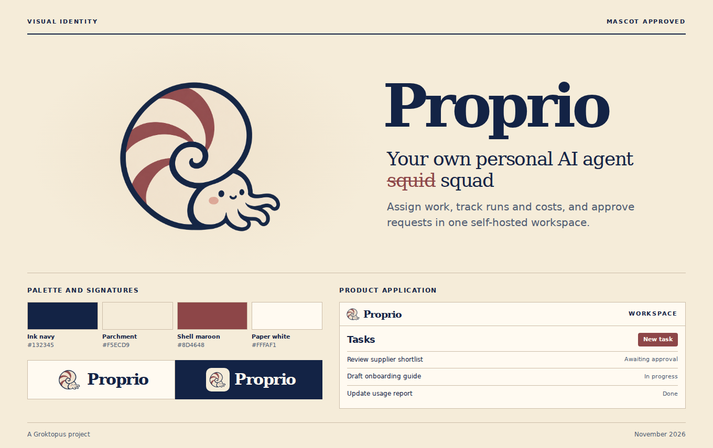

# Proprio brand kit

## Positioning

**Proprio is a self-hosted workspace for coordinating AI agents.** It gives operators a place to assign work, see what agents are doing, track costs, and decide what to approve.

**Brand slogan**

> Your own personal AI agent ~~squid~~ squad

Use the slogan on the brand board and in introductory materials. Pair it with the product description where readers need to understand what Proprio does. In text formats without strikethrough, write “Your own personal AI agent squad.”

The identity pairs a friendly, expressive character with a precise editorial system. The nautilus makes Proprio recognizable on its own. Navy ink, warm paper, maroon, and serif typography establish the family resemblance to the Groktopus sponsor brand. The freestanding silhouette and mixed-case wordmark give Proprio a different shape from the sponsor’s circular seal and the current Proprio “P” badge.

## Logo and wordmark

- The nautilus faces right. Its large spiral shell and three maroon bands are the main identifiers. The small smile and three short tentacles give it its kawaii character.
- Pair the mark with the mixed-case **Proprio** wordmark on docs, sign-in screens, and product headers. On dark surfaces, use a parchment tile for the mark and paper white for the wordmark.
- Use the mark alone for the app icon and avatar. Give the silhouette clear space equal to at least one eighth of its width. In the primary signature the name supplies the accessible label. Label standalone instances “Proprio” when they identify a destination.
- The full detail holds at the 32 px icon preview. At 16 px the face becomes indistinct. A production favicon should retain the spiral and outer profile and reduce the face and tentacle detail.
- Use the wordmark or lettering only once per lockup. Place the endorsement **A Groktopus project** in a footer, About page, or launch asset, where there is room for it.

## Palette

| Color | Hex | Role |
| --- | --- | --- |
| Ink navy | `#132345` | Wordmark, body text, dark brand panel |
| Parchment | `#F5ECD9` | Brand canvas and dark-surface logo tile |
| Shell maroon | `#8D4648` | Primary actions, links with a non-color affordance, shell bands |
| Paper white | `#FFFAF1` | Raised brand surfaces and text on navy or maroon |
| Slate | `#505D73` | Secondary text and focus on light surfaces |
| Warm rule | `#CCBDA8` | Decorative dividers |
| Blush | `#F1D5CC` | Illustration accent |

Flat sRGB contrast ratios are rounded to two decimal places.

| Pair | Ratio |
| --- | ---: |
| Ink navy and parchment | 13.21:1 |
| Ink navy and paper white | 14.92:1 |
| Shell maroon and parchment | 5.76:1 |
| Shell maroon and paper white | 6.51:1 |
| Slate and parchment | 5.67:1 |
| Slate and paper white | 6.40:1 |

Keep descriptive labels for status. Use semantic status colors in the product. Use the warm rule for decoration because its contrast against paper white is 1.77:1.

## Typography and composition

- Use a weighty mixed-case editorial serif for brand headlines and the wordmark. The board uses Georgia with a serif fallback for this concept.
- Use the product’s Inter for controls, body text, and dense lists. Retain the existing product monospace style for run IDs, timestamps, costs, and logs. The portable board uses a system sans.
- Use warm paper surfaces, fine rules, and a strong type hierarchy on public pages and documentation. In the app, reserve expressive typography for the brand signature and prominent entry surfaces. Operational views stay easy to scan.
- Use the mascot on welcome and empty states when the accompanying copy gives the operator a next action. Use sparse nautical linework for editorial illustrations where it supports the subject.

## Voice

Write to the operator in direct, calm language. Name the action and state. For example, “Awaiting approval,” “Retry run,” and “The run paused when it reached its budget limit.” The mascot supplies the playfulness.

## Application and handoff

The board shows the approved nautilus in proposed light and dark signatures and a task-list example. Start adoption at the browser icon, docs header, and sign-in surface. Apply brand colors through the existing app token layer when implementing the product theme. Treat the full app palette and its status colors as a separate implementation check.

| File | Use |
| --- | --- |
| [Brand board](proprio-brand-board.png) | Visual reference |
| [Nautilus mascot](proprio-nautilus.png) | Transparent 1312 × 1199 PNG of the approved mascot |
| [App icon](proprio-app-icon.png) | Parchment app tile, 512 × 512 PNG |

The approved mascot artwork is raster. Final production work includes a vector master, an outlined wordmark, and a dedicated 16 px favicon.

## Artwork provenance

The nautilus was created with the built-in ImageGen tool using the provided Groktopus reference as visual guidance. The swatch values above define the proposed palette. The generated artwork approximates those values.
